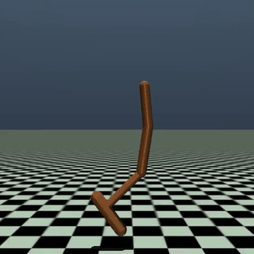
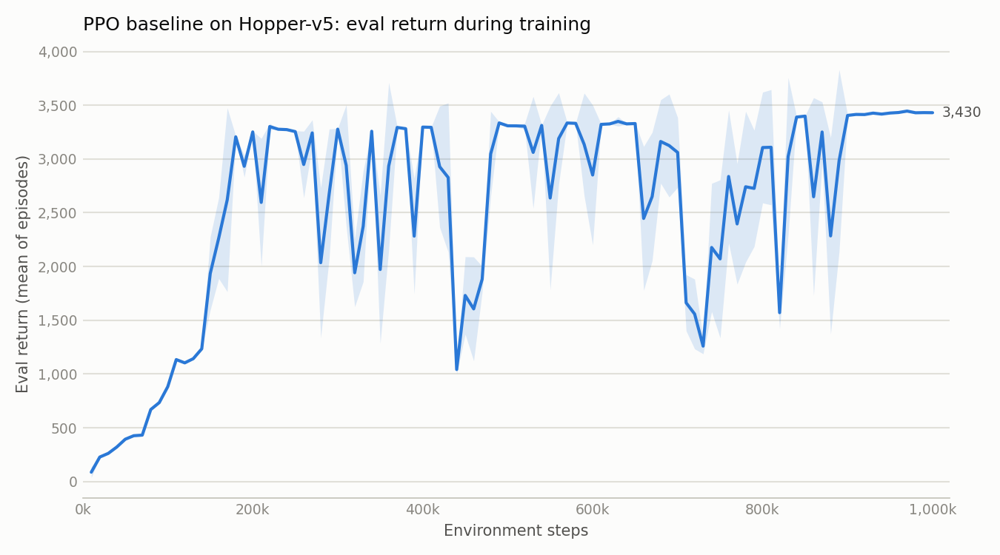
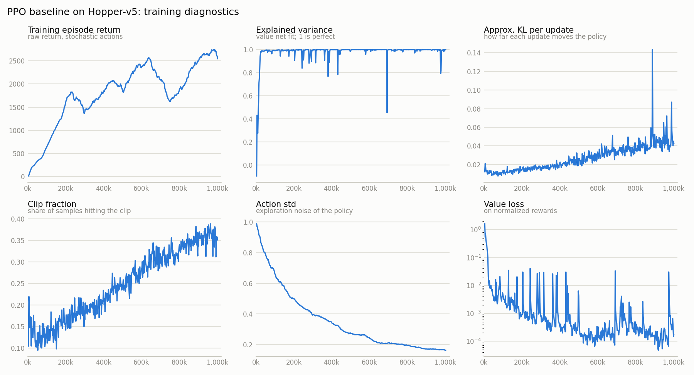
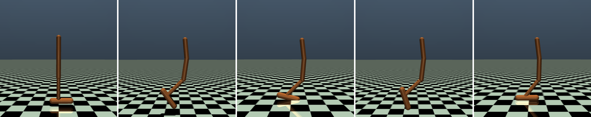
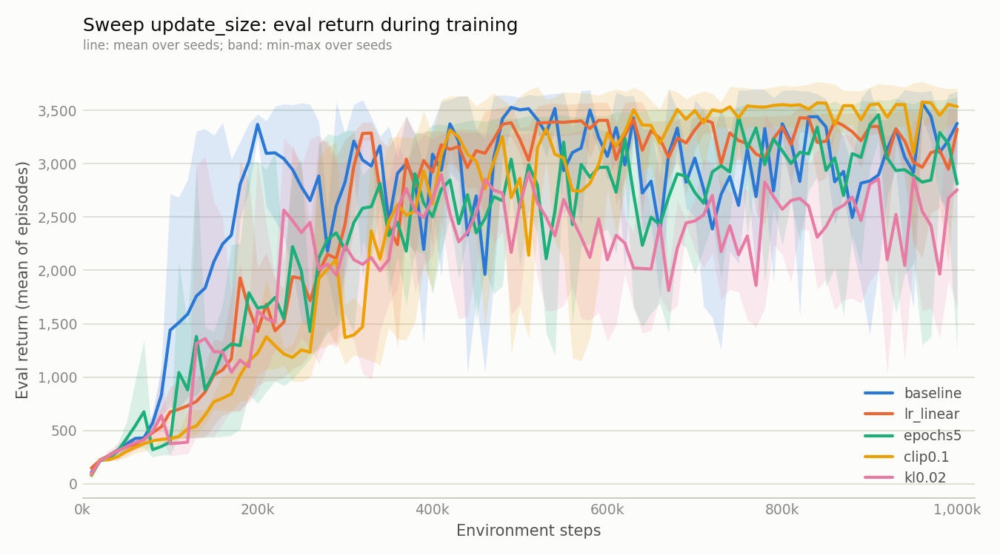
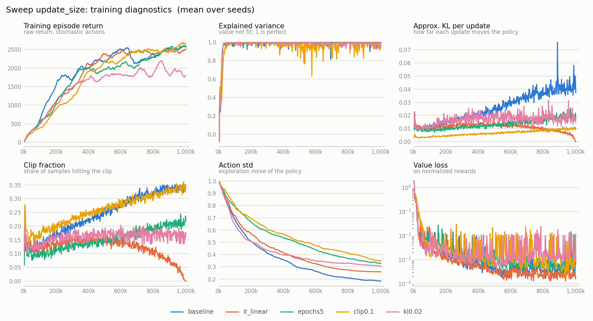
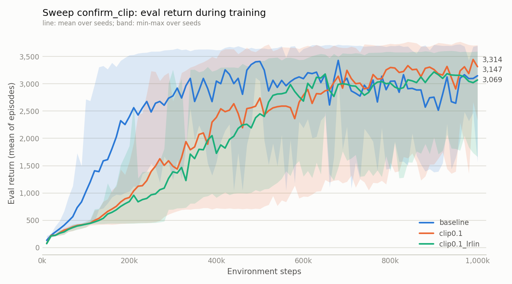

# Teaching a one-legged robot to hop: PPO on Hopper-v5

An experiment report on training Proximal Policy Optimization (Stable-Baselines3) on the
Gymnasium `Hopper-v5` MuJoCo task: a baseline, a sweep of settings that limit how far
each update moves the policy, and a 10-seed check of the most promising one.



*The baseline's best policy (return 3445 over 10 evaluation episodes).*

## Summary

- Standard MuJoCo PPO settings with observation and reward normalization learn to hop
  for the full 1000-step episode. 1M environment steps take about 6 minutes on a 4-core
  CPU. Best model of the baseline: return 3445 +/- 4 over 10 episodes.
- Learning is fast but unstable: after first passing 3000 at 180k steps, the baseline's
  eval return fell below 2000 ten more times before settling.
- As the policy grew more precise, each update moved it further (`approx_kl` 0.011 ->
  0.046). Four ways to limit the update size all reduced the KL. Cutting the number of
  updates (`target_kl`, fewer epochs) made training worse.
- A smaller clip range (0.1) looked better with 3 seeds. With 10 seeds per variant the
  end-of-training advantage was **not** confirmed (+280, p = 0.20), but the slowdown was:
  it reaches a return of 3000 about 2x later (p = 0.001).
- The largest effect in this study is the seed: the same settings end anywhere between
  about 2000 and 3600 (mean of the last 10 evaluations).

## 1. Task

`Hopper-v5` is a planar one-legged robot with four body parts (torso, thigh, leg, foot)
and three actuated joints.

| | |
|---|---|
| Observation | 11 numbers (joint angles and velocities, torso height and angle) |
| Action | 3 joint torques, each in [-1, 1] |
| Reward per step | forward velocity + 1 for staying upright - a small control cost |
| Episode end | the robot falls (unhealthy state), or 1000 steps are reached |
| Reward threshold | 3800 |

A return above about 3000 means the robot stays up for all 1000 steps while moving forward.

## 2. PPO in brief

PPO collects a batch of experience with the current policy (a *rollout*), uses it for
several passes of gradient updates (*epochs*), then throws it away and collects again.
Two ideas keep this stable:

- **Advantage**: how much better an action turned out than the value network expected.
  Estimated with GAE; `gae_lambda` trades bias for variance.
- **Clipping**: the ratio between the new and old probability of each action is clipped
  to [1 - `clip_range`, 1 + `clip_range`], so one batch cannot pull the policy too far.

The diagnostics used below come from Stable-Baselines3's training log:

| Metric | Meaning |
|---|---|
| `approx_kl` | how far one round of updates moved the policy |
| `clip_fraction` | share of samples whose probability ratio hit the clip |
| `explained_variance` | how well the value network predicts returns (1 = perfect) |
| `std` | standard deviation of the action noise (exploration) |

## 3. Method

**Algorithm.** PPO from Stable-Baselines3 2.9.2. Baseline settings
(`configs/ppo_hopper.toml`), the standard ones for MuJoCo tasks:

| Setting | Value |
|---|---|
| Total environment steps | 1,000,000 |
| Parallel environments | 8 |
| Rollout | 8 envs x 256 steps = 2048 steps |
| Learning rate | 3e-4, constant |
| Minibatch size, epochs | 64, 10 |
| Discount (`gamma`), GAE `lambda` | 0.99, 0.95 |
| Clip range | 0.2 |
| Entropy bonus | 0 |
| Networks | policy and value, 2 hidden layers of 64 units each, tanh |
| Normalization | running mean/std of observations; rewards scaled by the return's std |

**Normalization statistics are part of the model.** A policy trained on normalized
observations only works with the same running mean and variance. Every saved model is
stored with its statistics (`*_vecnormalize.pkl`), and evaluation uses them without
updating them.

**Evaluation.** Every 10,000 steps the current policy is run for 5 episodes with
deterministic actions and raw rewards; the mean return is the "eval return" in the tables
and curves. The model with the highest eval return is kept as the best model. At the end,
models are scored again over 10 episodes.

**Hardware and software.** Intel Core i3-14100F (4 cores, 8 threads), Python 3.13,
PyTorch 2.11, Gymnasium 1.4, MuJoCo 4.0. Exact versions are in `requirements.txt`.

**Speed.** `tests/bench_speed.py` compared hardware settings (20,480 steps each, best of 3):

| Setting | Steps/s | 1M steps |
|---|---|---|
| CPU, 1 environment | 1854 | 9.0 min |
| CPU, 8 environments in one process, 1 PyTorch thread | 3551 | 4.7 min |
| CPU, 8 environments, one process each | 3381 | 4.9 min |
| GPU (RTX 3060), 8 environments, one process each | 2598 | 6.4 min |

The networks are too small for the GPU to help, and a Hopper physics step is so cheap that
one process per environment gives nothing. The runs use 8 environments in one process
with 1 PyTorch thread; each run then uses about one core, so three can train in parallel
at full speed.

## 4. Results

### 4.1 Baseline

| | |
|---|---|
| Training time | 374 s for 1M steps (including evaluations) |
| Best model, 10 eval episodes | 3445.5 +/- 4.0, all episodes 1000 steps |
| Final model, 10 eval episodes | 3281.5 +/- 472.1, one episode fell early |
| First eval above 1000 / 3000 | 110k / 180k steps |
| Reward threshold (3800) | not reached |



*Eval return during training. The band is +/- one standard deviation over the 5 eval episodes.*

After reaching 3000, the eval return dropped below 2000 in 10 of the next 82 evaluations
(lowest 1042 at 440k) and only settled in the last ~100k steps.



*PPO diagnostics of the same run.*

- The value network fits well: `explained_variance` stays near 0.99, with brief dips that
  line up with the return collapses.
- The action noise shrinks from about 0.8 to 0.17. Over the same time `approx_kl` rises
  from about 0.011 to 0.046 and `clip_fraction` from 0.13 to 0.36. With a fixed learning
  rate and 10 epochs over each rollout, updates move a narrow policy further. This was
  the starting point of the sweeps.



*The best policy at 0, 25, 50, 75 and 100% of one episode. It travels about 19.5 m.*

### 4.2 Sweep 1: limiting the update size (5 variants x 3 seeds)

Each variant changes one setting that limits how far the policy moves per rollout
(`configs/sweeps/update_size.toml`).

| Variant | Change |
|---|---|
| baseline | - |
| lr_linear | learning rate decays linearly from 3e-4 to 0 |
| epochs5 | 5 epochs instead of 10 |
| clip0.1 | clip range 0.1 instead of 0.2 |
| kl0.02 | `target_kl` 0.02: a round of updates stops once `approx_kl` exceeds 0.03 |

Means over seeds 0-2, min-max in brackets. "Collapse rate": share of evaluations below
2000 after the first one above 3000. "Late": mean of the last 50 updates.

| Variant | Mean of last 10 evals | Final model | First eval >= 3000 | Collapse rate | Late `approx_kl` | Late epochs per rollout |
|---|---|---|---|---|---|---|
| baseline | 3205 (2877-3427) | 3342 | 167k | 9% | 0.042 | 10 |
| lr_linear | 3143 (2644-3489) | 3100 | 270k | 3% | 0.006 | 10 |
| epochs5 | 3025 (1992-3566) | 2651 | 373k | 15% | 0.019 | 5 |
| clip0.1 | 3490 (3325-3734) | 3478 | 337k | 6% | 0.010 | 10 |
| kl0.02 | 2477 (1903-2823) | 2802 | 307k | 26% | 0.018 | 2.7 |



*Mean over 3 seeds; the band spans the lowest and highest seed.*



*PPO diagnostics, mean over 3 seeds.*

- Every variant lowered the late `approx_kl`, so each setting did what it says.
- `kl0.02` stopped each round after about 2.7 of 10 epochs late in training, and was the
  worst variant on every measure. `epochs5` was also worse and varied most between seeds.
  Fewer passes over the data means less learning per rollout.
- `clip0.1` had the best and most consistent end result. Its clip fraction stays as high as
  the baseline's (a narrower clip catches more samples), but its KL stays low.
- The baseline reached 3000 first; every stabilizing change slowed early learning.

**Significance.** Permutation tests on per-run values (`python compare.py
configs/sweeps/update_size.toml`) found nothing significant: with 3 runs against 3,
there are only 20 ways to split the runs, so no difference can reach p < 0.10.
`clip0.1` vs baseline on the mean of the last 10 evals: +285, p = 0.40.

### 4.3 Sweep 2: does clip 0.1 really end better? (3 variants x 10 seeds)

`configs/sweeps/confirm_clip.toml`. The analysis was fixed before running: primary metric
= mean of the last 10 evaluations, exact two-sided permutation test against the baseline
(10 runs vs 10). Seeds 0-2 reproduce sweep 1 exactly.

| Metric | baseline | clip0.1 | clip0.1 + linear lr decay |
|---|---|---|---|
| **Mean of last 10 evals** | 2937 (2020-3639) | 3217: +280 [-115, 666], **p = 0.20** | 3118: +181 [-290, 618], p = 0.46 |
| Final model, 10 episodes | 3102 (1664-3547) | 3245: +143, p = 0.57 | 2989: -113, p = 0.72 |
| First eval >= 3000 | 217k (130-330k) | 444k: +227k, **p = 0.001** | 486k: +269k, **p = 0.0002** |
| Collapse rate | 10.7% | 9.4%, p = 0.75 | 16.2%, p = 0.82 * |

*Means over 10 seeds; difference vs baseline with a 95% bootstrap interval in brackets.
\* One run (seed 9) never reached 3000 and counts as 100%; the median is 0.7%.*



*Mean over 10 seeds; the band spans the lowest and highest seed.*

- **The end-performance advantage of `clip0.1` is not confirmed.** The mean difference is
  the same as in sweep 1 (+280 vs +285), but the baseline's spread over 10 seeds is far
  wider than its first 3 seeds suggested. The interval includes zero; an effect of up to
  about +650 cannot be ruled out either.
- **The slowdown is confirmed.** A clip range of 0.1 halves how far each update may move
  the policy, and the robot reaches 3000 about twice as late.
- Adding learning-rate decay did not help on any metric.

## 5. Discussion

- **Settings set the range; the seed picks the point.** A bad setting (`kl0.02`) was worse
  on every seed. Among reasonable settings, the seed alone moved the end result between
  about 2000 and 3600, more than any setting did.
- **A smaller KL is not the goal in itself.** Every variant reduced it, but only the ones
  that kept the number of updates (smaller clip, learning-rate decay) did not hurt.
- **Three seeds can mislead.** Sweep 1 ranked `clip0.1` first with a clean margin; ten seeds
  showed that the baseline's first three seeds were among its better ones. Fixing the
  metric and test before sweep 2 kept the conclusion honest.
- **Keep the best model.** Because the eval return collapses and recovers, the final model
  is a poor choice (baseline seed 6: best eval 3690, final model 1664).
- For comparison, the earlier SAC project on the same task reached 3228 after 300k steps
  (24 minutes on a GPU); PPO used more steps but much less wall-clock time.

## 6. Limitations

- One environment, 1M steps per run. Longer training might change the picture.
- Evaluations use 5 episodes; single evaluations are noisy.
- The baseline and sweep 1 are reported per seed or with 3 seeds only; only sweep 2 has
  enough runs for significance tests.
- Resuming a stopped run re-seeds the random generators, so a resumed run is not identical
  to an uninterrupted one. None of the reported runs were interrupted.

Possible follow-ups: turn normalization off to see how much it matters; vary the rollout
length, `gae_lambda`, the entropy bonus and the network size; compare with the RL Zoo's
tuned Hopper settings.

## 7. Reproducing

Install the packages in `requirements.txt` into a Python 3.13 environment
(a conda env named `rl` was used here).

```bash
# Train (1M steps, about 6 min on a 4-core CPU). Ctrl+C saves progress.
python train.py
python train.py --set ppo.clip_range=0.1 --tag clip0.1     # change one setting
python train.py --resume runs/<run_name>                   # continue a stopped run

# Watch training live
tensorboard --logdir runs

# Score a saved model and record videos (each with a frame sheet and a camera check)
python evaluate.py runs/<run_name>                     # best model, 10 episodes
python evaluate.py runs/<run_name> --video --gif       # + videos/best.mp4, best.gif
python evaluate.py runs/<run_name> --video-stages      # one video per checkpoint

# Learning curve and PPO diagnostics
python plot.py runs/<run_name>
python plot.py runs/<a> runs/<b> --out compare

# The sweeps in this report (skip finished runs, resume stopped ones)
python sweep.py configs/sweeps/update_size.toml --jobs 3    # about 35 min
python sweep.py configs/sweeps/confirm_clip.toml --jobs 3   # about 75 min
python compare.py configs/sweeps/confirm_clip.toml          # significance tests

# Checks
python tests/quick_check.py      # whole pipeline in about a minute
python tests/check_resume.py     # Ctrl+C and hard kill, then resume
python tests/check_camera.py     # videos keep the robot in view
python tests/bench_speed.py      # hardware settings
```

The `runs/` folder (models, logs, videos) is not part of this repository; the commands
above recreate it. With the same seed and settings, a run reproduces exactly on the same
machine.

### Videos and the camera

Videos use Hopper's `track` camera, which follows the robot. Every frame is checked: the
torso is projected into the image, and `evaluate.py` warns and exits with an error if it
leaves the middle of the frame. `tests/check_camera.py` moves the robot up to 100 m and
confirms that it stays centered, and that a still camera would be caught. Hopper draws its
floor only to 20 m, and a good policy travels about 20 m, so the video environment draws
it to 200 m. A MuJoCo plane collides as an infinite plane, so the physics is unchanged;
the test confirms identical trajectories.

### How resuming works

- Every 10k steps (at the start of the next rollout, right after an update) the model, its
  normalization statistics and `state.json` are saved to `resume/`. Files are written
  under a temporary name and then renamed, so a crash while saving keeps the previous
  snapshot.
- Ctrl+C saves at the current step. A hard kill falls back to the last snapshot; eval and
  training-log rows and checkpoints newer than it are dropped on resume.

## 8. Repository layout

```
train.py, evaluate.py, plot.py   entry points
sweep.py, compare.py             run variants x seeds; test the differences
configs/ppo_hopper.toml          baseline settings
configs/sweeps/*.toml            lists of variants (and seeds) to compare
hopper_ppo/
  config.py       settings (TOML -> dataclass), run folder layout
  builders.py     training, evaluation and video environments; the PPO model
  checkpoint.py   models saved with their normalization statistics; snapshots
  callbacks.py    periodic evaluation, checkpoints, snapshots
  metrics.py      evaluation and training-metric CSV logs, run summaries
  media.py        videos, camera check, frame sheets, charts
assets/           figures used in this report
docs/             working notes (progress.md) and per-run sweep results (*.csv)
tests/            checks and the speed benchmark
runs/<run_name>/  created by training (not in the repository)
  config.toml, state.json
  models/         best_model.zip + best_vecnormalize.pkl, final_*
  checkpoints/    step_0100000.zip + step_0100000_vecnormalize.pkl, ... (every 100k)
  resume/         latest snapshot (overwritten every 10k steps)
  logs/           evals.csv, progress.csv, train_monitor/, score_final.json
  tensorboard/, videos/, plots/
```
